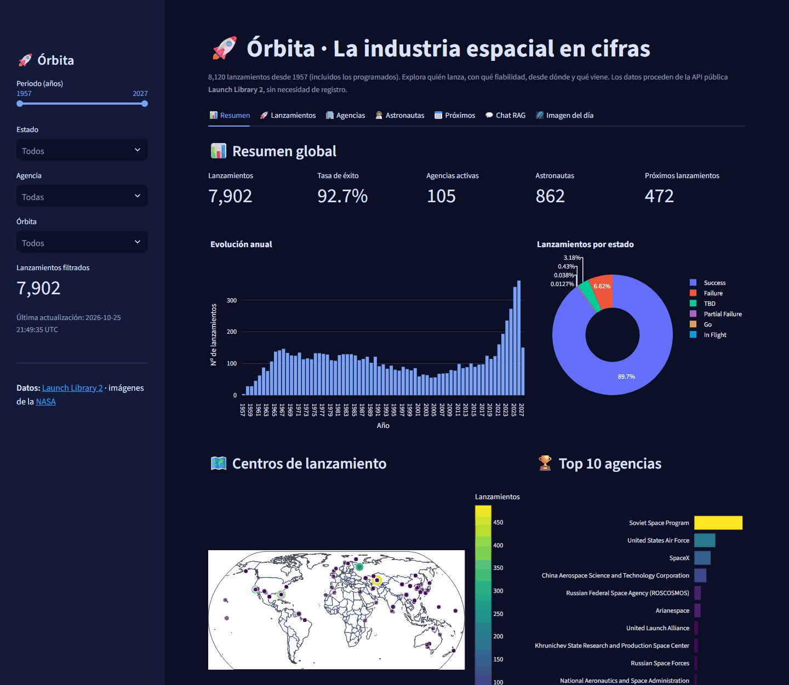
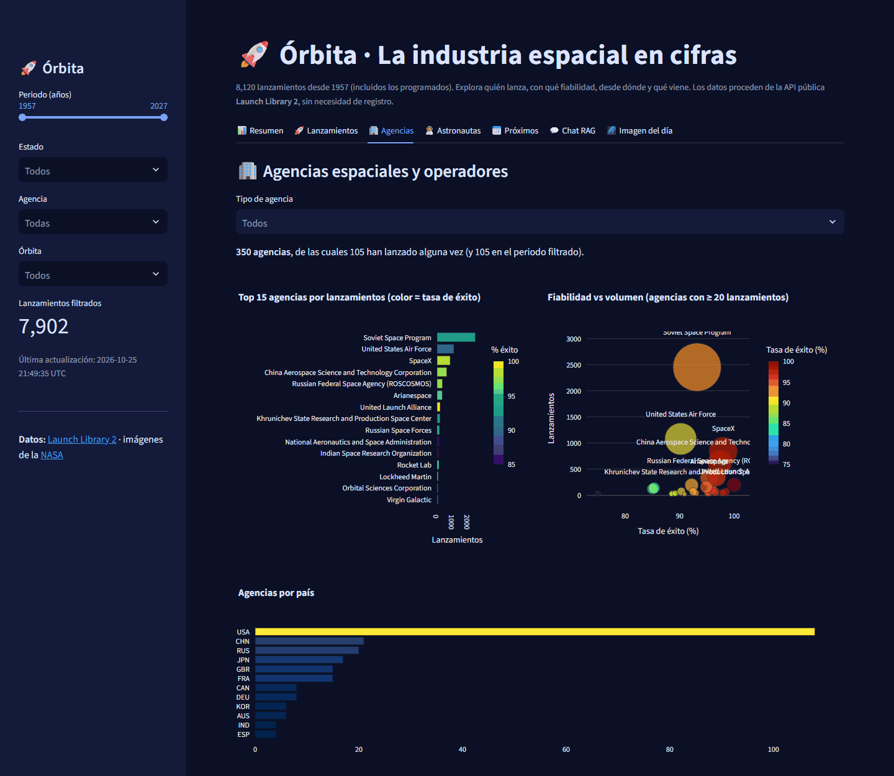

# Órbita — la industria espacial en cifras

**Quién lanza al espacio, con qué fiabilidad, desde dónde y qué viene: 8.120 lanzamientos desde 1957 con datos de Launch Library 2.**

[](https://orbita-espacio.vercel.app) [](https://github.com/alvarodc093-pixel/Orbita/actions/workflows/ingesta.yml)    



## En resumen

- **Problema:** el sector espacial ha pasado de 3 lanzamientos en 1957 a más de 300 al año, y seguir quién lanza, con qué fiabilidad y desde dónde exige cruzar muchas fuentes.
- **Datos:** 8.120 lanzamientos, 350 agencias, 862 astronautas y 240 rampas de la API pública Launch Library 2, en SQLite y actualizados cada semana con GitHub Actions.
- **Resultado:** 2025 marca un récord de 341 lanzamientos; SpaceX lanza desde 2021 más que sus cuatro siguientes competidores juntos, y Falcon 9 es el cohete más usado y el más fiable (99,4 %).
- **App:** dashboard en Streamlit con resumen, mapa de centros de lanzamiento, agencias, cohetes, astronautas y calendario de próximos lanzamientos, ejecutado en el navegador.

## Datos

- **Fuente:** [Launch Library 2](https://thespacedevs.com/llapi) (The Space Devs), API pública sin registro. La imagen del día viene de la API APOD de la NASA.
- **Contenido:** cada lanzamiento con su fecha, estado, cohete, agencia, misión, órbita y rampa; además, agencias, astronautas, centros y rampas de lanzamiento. El esquema está en [`diccionario_datos.md`](diccionario_datos.md).
- **Tasa de éxito:** se calcula solo sobre lanzamientos ya realizados (éxito, fallo o fallo parcial). Los programados no cuentan como fallos.
- **Ingesta:** `ingesta.py` descarga con caché, reanuda si se interrumpe y espera cuando la API limita las peticiones. La carga histórica usa el endpoint de desarrollo de Launch Library 2 (sin límite); las actualizaciones semanales, el de producción.

## Hallazgos

Del notebook [`notebooks/eda.ipynb`](notebooks/eda.ipynb), con datos del 25/10/2026:

- **Récord de actividad:** 341 lanzamientos en 2025, más del doble que en el pico de la carrera espacial (146 en 1967). Entre 2016 y 2025 se hicieron 1.755, frente a 1.277 entre 1966 y 1975.
- **Fiabilidad:** el 92,7 % de los 7.647 lanzamientos realizados tuvo éxito. En los años 50 era el 41 %; desde los 70 se mantiene por encima del 93 %.
- **SpaceX:** 624 lanzamientos desde 2021, más que sus cuatro siguientes competidores juntos (492). China (CASC) es la segunda potencia actual.
- **Cohetes:** Falcon 9 suma 699 vuelos y un 99,4 % de éxito, por delante del Long March 2D (99,0 %) entre los cohetes con más de 20 vuelos.
- **Órbitas:** el 56 % de los lanzamientos va a la órbita baja; Starlink suma por sí solo 429.
- **Geografía:** Plesetsk (1.688) y Baikonur (1.565) dominan el histórico; desde 2021 lideran Cabo Cañaveral (321) y Vandenberg (233).
- **Astronautas:** 862 de 68 nacionalidades, con EE. UU. (493) y Rusia (139) como mayoría.

## La app



| Pestaña | Contenido |
|---|---|
| Resumen | KPIs, evolución anual, lanzamientos por estado, mapa de centros y top de agencias |
| Lanzamientos | Filtros por año, estado, agencia y órbita; cohetes y órbitas más usados; ficha de cada lanzamiento |
| Agencias | Volumen frente a fiabilidad y tabla por tipo y país |
| Astronautas | Nacionalidades, estado, década del primer vuelo y biografías |
| Próximos | Calendario de lanzamientos programados |
| Chat | Preguntas en lenguaje natural sobre los datos (solo en local) |
| Imagen del día | Fotografía astronómica de la NASA |

El chat usa ChromaDB y un modelo local de Ollama (`nomic-embed-text` para los embeddings y `llama3.2` para la respuesta), así que no está disponible en la demo web.

## Ejecutarlo en local

```bash
pip install -r requirements.txt
streamlit run app.py               # la base ya viene en data/espacio.db

python ingesta.py --update         # añade los lanzamientos nuevos
python preparar_corpus.py          # opcional: índice del chat (requiere Ollama)
```

Para la carga completa desde cero: `LL2_BASE_URL=https://lldev.thespacedevs.com/2.0.0/ python ingesta.py`. La clave de la NASA es opcional (`NASA_API_KEY` en `.streamlit/secrets.toml`); sin ella se usa `DEMO_KEY`.

## Estructura

```text
├── app.py                    # App de Streamlit (7 pestañas)
├── index.html                # Demo web (stlite)
├── ingesta.py                # Launch Library 2 → SQLite (caché, reanudación, modo incremental)
├── preparar_corpus.py        # Fichas de lanzamientos, cohetes, agencias y astronautas → ChromaDB
├── data/espacio.db           # Base de datos
├── notebooks/eda.ipynb       # Análisis exploratorio
├── diccionario_datos.md
└── .github/workflows/        # Ingesta semanal
```

## Limitaciones

- Algunos lanzamientos programados tienen fechas de relleno lejanas (hasta 2039); la app limita el periodo al año que viene.
- El listado de astronautas de la API no incluye el número de vuelos, así que se analiza la década del primer vuelo.
- El endpoint de desarrollo usado para la carga histórica puede ir algo por detrás del de producción; la actualización semanal lo corrige.

## Autor

Álvaro Domingo Cordón · [LinkedIn](https://www.linkedin.com/in/alvaro-domingo/) · [GitHub](https://github.com/alvarodc093-pixel)

Datos de [The Space Devs](https://thespacedevs.com) e imágenes de la [NASA](https://api.nasa.gov).
